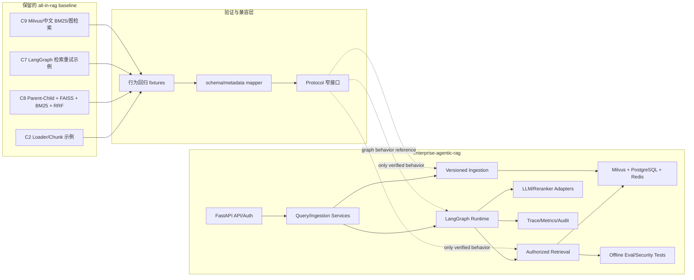
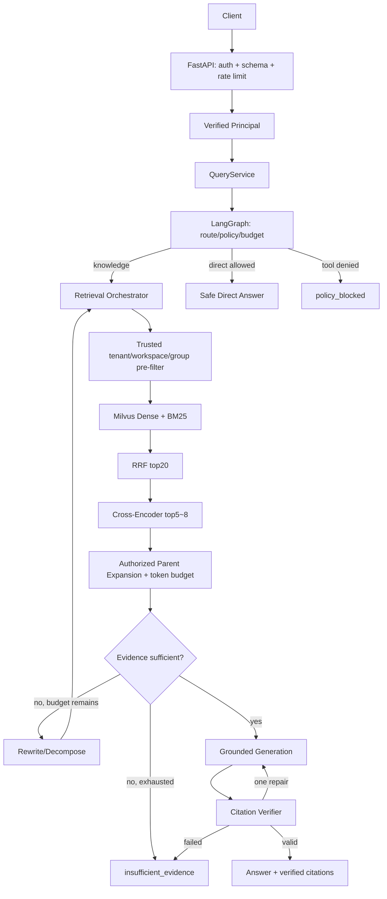

# Enterprise Agentic RAG 增量升级架构（阶段 00）

## 1. 目标与边界

本项目在现有 `/home/laiho/projects/all-in-rag` 工作树内新增 `enterprise-agentic-rag/` 产品子项目。旧教程与本地部署保留为 baseline，不移动、不重命名、不批量格式化；新产品通过窄接口对已验证算法行为进行包装，并补齐企业场景所需的身份、授权、版本、可观测性和测试。

唯一 P0 主场景是：基于虚构企业 Northstar Tech 的内部制度，在检索前完成 tenant/workspace/group ACL 限制，生成有真实可定位引用的回答；证据不足或越权时拒答。

## 2. 从旧基线到产品路径



兼容层不允许把旧模块的网络连接、全局状态或不安全过滤直接带入产品。复用的是经过测试的算法行为和数据转换，不是整个脚本的 import-time 副作用。

## 3. P0 查询数据流



安全不变量：未经授权的 chunk 不进入 reranker、LLM、cache 或 trace；router 只能提出建议，PolicyEngine 最终裁决；所有循环受 retry/tool/round/deadline 预算约束。

## 4. Ingestion 数据流

```text
upload validation
  → safe PDF/Markdown/HTML parse
  → canonical text + content hash
  → stable parent/child IDs + source/page/heading metadata
  → tenant/workspace/group ACL + acl_version
  → embed/index new document_version
  → validate write
  → atomically activate index_version
  → invalidate versioned cache
```

child 用于召回，parent/邻域用于生成。父文档回填必须再次检查同一 tenant、ACL 和 activated version，并受 token budget 限制。

## 5. 模块边界

| 模块 | 责任 | 禁止事项 |
|---|---|---|
| `app/api` | 认证、校验、协议映射、SSE | 放业务检索逻辑；信任 body 中身份 |
| `app/services` | 查询与 ingestion 用例编排 | 绕过 PolicyEngine 或直接拼数据库查询 |
| `app/ingestion` | 安全解析、稳定分块、去重、版本写入 | 依赖 FastAPI/LangGraph；import-time 网络 |
| `app/retrieval` | Dense/BM25、RRF、rerank、context、citation | post-filter 授权；访问未授权候选 |
| `app/agents` | 路由、评分、重写、多跳、预算和终止 | 把身份/权限交给 LLM 决定；无限循环 |
| `app/stores` | Milvus/PostgreSQL/Redis/checkpoint adapter | 裸 `session_id` 或无 tenant scope 的读写 |
| `app/llm` | async provider、schema validation、usage/cost | 无 timeout 重试；把估算冒充实测 |
| `app/observability` | trace、结构化日志、metrics、审计 | 记录密钥、完整 prompt/文档、PII |

## 6. Baseline 保护与回归策略

1. 旧 `code/` 继续按原命令运行，不从产品包反向 import 旧脚本。
2. 从旧实现提炼固定输入/输出 fixtures：Markdown 标题分块、Parent–Child 映射、Dense、中文 BM25、RRF 和 rewrite。
3. 每次迁移先比较旧 baseline，再验证产品契约与安全负例；fake 仅证明契约，不能替代真实 Milvus。
4. C4 会创建/删除 collection 的脚本不进入默认测试；C7 Web 工具不在 P0 注册。
5. 原有未提交改动始终保留；阶段性工作只落在新产品子目录及指导文档。

## 7. 当前可用性与阻塞

- 已验证：Python 3.12、本地 GPU、本地 BGE embedding、LangChain/LlamaIndex 离线检索、Neo4j 只读连接、C8 RRF 行为。
- 当前阻塞：Milvus 容器未运行（19530 未监听）；真实 C8/C9 生成因避免收费 API 未执行；C4 rerank/hybrid 因模型下载和破坏性集合操作未执行。
- 阶段 01 只建立最小产品脚手架与 fake/local health path，不提前连接 Milvus、DeepSeek 或创建整套空目录。

## 8. Git 与发布边界

当前 Git 身份为 `laihongxiang12`，但 `origin` 指向 `datawhalechina/all-in-rag`。在第一次提交或推送前，需由用户确认个人 GitHub 目标仓库，并决定保留 upstream `origin`、新增个人 remote，或调整 remote 命名。任何选择都不能丢失现有提交和未提交改动。

旧仓库 README 声明 CC BY-NC-SA 4.0。产品代码凡复制或形成衍生关系的部分必须保留 provenance/attribution 并遵守许可；无法确认时只复现公开行为并独立实现。
